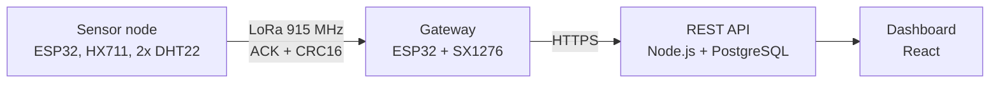

# Ruan Silveira

**Industrial Instrumentation | Embedded Systems | IoT for the field**

Industrial maintenance technician specializing in instrumentation (transmitters, control valves, analyzers and control loops) and Electrical Engineering student in the final year.
I build systems that carry a measurement from the field to the screen: sensors, embedded firmware, radio links, APIs and dashboards, designed to keep working in real operating conditions.

🇧🇷 Em português

 

Técnico de manutenção especializado em instrumentação industrial (transmissores, válvulas de controle, analisadores e malhas de controle) e estudante de Engenharia Elétrica no último ano.
Desenvolvo sistemas que levam uma medição do campo até a tela: sensores, firmware embarcado, comunicação por rádio, APIs e painéis, projetados para continuar funcionando em condições reais de operação.

---

## Smart Beehive Monitoring System

End-to-end IoT system that monitors beehive weight, internal and external climate and battery level, from a solar-powered sensor node in the field to a web dashboard.

| Layer | Repository | Highlights |
|---|---|---|
| Sensor node | [esp32-beehive-sensor-node-lora](https://github.com/rusilveira/esp32-beehive-sensor-node-lora) | Deep sleep cycle, boot watchdog, failure counter in RTC memory, validated on battery and solar power |
| Radio protocol | [esp32-lora-reliable-link](https://github.com/rusilveira/esp32-lora-reliable-link) | Custom packet format with ACK, CRC16, sequence numbers and retransmission; SX1276 TX to RX switching issue found and fixed |
| Gateway | [esp32-beehive-lora-gateway](https://github.com/rusilveira/esp32-beehive-lora-gateway) | Validates, deduplicates and forwards readings over Wi-Fi, recovers from Wi-Fi and API failures on its own |
| API | [mms-backend](https://github.com/rusilveira/mms-backend) | Node.js, Express and PostgreSQL, deployed on Render, with simulators for testing without hardware |
| Dashboard | [mms-frontend](https://github.com/rusilveira/mms-frontend) | Status classification (normal, attention, critical), history charts, offline detection. [Live demo](https://hive-plus-dashboard.vercel.app) |

The sensor node was developed in stages: [base firmware](https://github.com/rusilveira/esp32-beehive-sensor-node-base) (sensors and calibration), [low-power version](https://github.com/rusilveira/esp32-beehive-sensor-node-deepsleep) (deep sleep) and the final [LoRa node](https://github.com/rusilveira/esp32-beehive-sensor-node-lora).

---

## EDUTECS research group website

Institutional website for the EDUTECS research group (Education, Technologies and Systems) at Uniplac, Lages, SC, Brazil, with a project funded by FAPESC.
I designed and developed it: a static site built with Astro and TypeScript, content edited by a non-technical coordinator through a visual CMS, strict security headers (Content Security Policy), accessibility checks and automated deployment on Cloudflare.

[Visit the website](https://site-grupo-pesquisa.ruanpfs.workers.dev) · source code kept private by the research group

---

## Instrumentation in Practice

[instrumentation-in-practice](https://github.com/rusilveira/instrumentation-in-practice): a progressive series of Python projects on industrial instrumentation and process control (4 to 20 mA signals, level measurement, PID, control valves), each one backed by verifiable references and validated results.

---

## Tech stack

| Area | Tools |
|---|---|
| Embedded | C/C++, ESP32, PlatformIO, Arduino framework, LoRa (SX1276, RadioLib), HX711, DHT22, deep sleep |
| Backend | Node.js, Express, PostgreSQL, REST APIs |
| Web | React, Vite, Astro, TypeScript, HTML, CSS |
| Field | Industrial instrumentation, transmitters, control valves, analyzers, control loops, calibration |

---

## Contact

[LinkedIn](https://www.linkedin.com/in/ruan-silveira-494110257)
